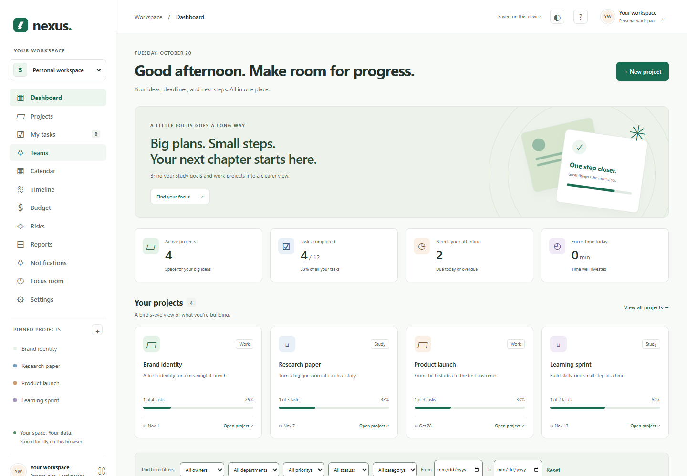

# Project Nexus

A polished project workspace for students, professionals, and small teams. Organize delivery work, understand portfolio health, track cost and risk, and produce project-status PDFs.



Choose how to run the app:

| Mode | Start | Data and access |
| --- | --- | --- |
| GitHub Pages / local demo | `npm start` | Browser-local sample workspace. No accounts or security boundary between people using the same browser. |
| Local account demonstration | `npm run start:demo` | Five local accounts using the real API, with server-enforced roles and separate demo data. |
| Connected organization | `npm run start:server` | Express + TypeScript API, PostgreSQL, real accounts, server-enforced roles and project access. |

The full application cannot run entirely on GitHub Pages: Pages hosts static files. The frontend can connect to a separately hosted HTTPS API. GitHub also restricts commercial SaaS hosting on Pages; use it for the project demonstration and choose suitable hosting for a commercial service. See [GitHub Pages limits](https://docs.github.com/en/pages/getting-started-with-github-pages/github-pages-limits).

## Run locally

Use Node.js 24 LTS and npm. Windows, macOS, and Linux are supported.

```sh
npm ci
npm start
```

Open `http://127.0.0.1:4173`. The static mode does not need a database, account, API key, or build step. Serve over HTTP; opening `index.html` directly as a file does not support the JavaScript module workflow reliably.

To try the customized login screen and role-based profiles:

```sh
npm run start:demo
```

Open `http://127.0.0.1:4174`. Choose a profile to fill the login form, then select **Sign in**. All five profiles use the local-demo password **`NexusDemo!26`** (12 characters):

| Profile | Email | Access |
| --- | --- | --- |
| Administrator | admin@nexus.test | Organization settings, people, permissions, and all projects |
| Professional | manager@nexus.test | Project manager: delivery, assignments, budgets, resources, and risks |
| Student | student@nexus.test | Team member: assigned study projects and tasks |
| Teammate | member@nexus.test | Team member: approved projects and assigned work |
| Viewer | viewer@nexus.test | Approved projects and reports; own profile/preferences |

These `.test` addresses are local account identifiers, not real email inboxes. Use sample data only. The profile buttons fill the form; every sign-in still goes through the API and its permission checks.

`start:demo` binds to localhost, does not read `.env`, clears inherited database/email configuration, and persists its embedded PostgreSQL data separately in `.data/account-demo`. Restarting preserves accounts and workspace edits. Its per-run signing secret invalidates old access tokens, while a valid refresh cookie can restore the session.

For a configured connected edition, copy `.env.example` to `.env`, then run:

```sh
npm run start:server
```

With `DEMO_SEED=1` outside production, the same demo profiles are provisioned. Demo seeding is disabled in production. Without `DATABASE_URL`, configured local development uses embedded PostgreSQL via PGlite, persisted in `.data/postgres`. Production requires a real PostgreSQL connection. Seed upgrades preserve edited profiles and custom passwords; only recognized demo users still using the former public password are migrated to the current one.

Without SMTP in development, invitation and reset links are printed to the local server terminal. Invitations also show a development link in the UI. In production, configure SMTP; reset tokens are never returned by the API.

## What works

- Projects: ownership, department, category, priority, client, team membership, start/target dates, status, health, success criteria, tags, budget allocations, archive/restore, and documents.
- Tasks: CRUD, assignees, estimates, labels, statuses, priorities, due dates, subtasks, checklists, comments, watchers, dependencies, history, and attachments.
- List and Kanban views with accessible status selectors and drag-and-drop. Dependencies reject cycles and completion before prerequisite work.
- Portfolio KPIs, date/department/owner/priority/category/status filters, health distribution, progress charts, workloads, upcoming milestones, blockers, and recent activity.
- Team capacity, overload/availability indicators, equipment, licenses, and rooms.
- Budgets, categorized expenses, utilization, forecast variance, category allocations, spending trends, and overspend alerts. Amounts are USD; summary arithmetic uses integer cents.
- Risk register, owners, probability × impact scoring, 5 × 5 heat map, mitigation progress, and overdue actions.
- Timeline, milestones, and calendar with tasks, meetings, leave, and reminders.
- In-app inbox, read/unread states, notification preferences, current alerts, and activity history.
- Portfolio, project, budget, risk, and workload PDF reports with summary, KPIs, exceptions, and upcoming actions.
- Focus sessions, keyboard shortcuts, validated JSON backups, empty/error states, and responsive layouts.
- Light, Dark, and System appearance with Forest, Ocean, Violet, and Amber accents; preferences persist independently of workspace data.
- Connected mode: customized login/registration/recovery/invitation screens, password visibility control, five local demo profiles, login/logout, reset links, invitations, activation/deactivation, roles, organization settings, and department configuration.
- Top-right account menu: profile details and display-name editing, security and sign-in information, appearance, account switching, and sign-out.

Select a workspace to view study projects, professional projects, or both. Project details contain delivery controls and related records. Settings includes backups and notification preferences appear in Notifications.

Keyboard shortcuts: `N` new task, `P` new project, `/` task search, and `Esc` close a dialog. Shortcuts are inactive while editing a field. Native dialogs trap keyboard focus.

## Account access

Open your name/avatar in the top-right corner. **My profile** shows your email, role, and department and lets you update your display name. **Security & sign-in** explains your access and lets you request a password-reset link. **Switch account** signs out the current session before returning to the login screen; selecting another demo profile cannot bypass authentication. **Sign out** ends the session.

The account menu supports keyboard navigation, Escape to close, and focus returning to the trigger. In static mode it identifies the browser-local workspace and explains how to use the connected edition. A static Pages deployment needs a configured API before email/password sign-in is available.

[Login preview](docs/login-light.png) · [Dark login preview](docs/login-dark.png) · [Account menu preview](docs/account-menu.png)

## Appearance

Use the sun/moon button in the top bar for a quick light/dark switch. Open **Settings → Appearance** for **Light**, **Dark**, or **System** and four accent palettes. System follows your device's preference, including changes while the app is open.

Preferences apply before the interface paints, persist across reloads, and synchronize between tabs on this origin. They contain only the mode and accent, never account or project data. If browser storage is blocked or full, the current tab still changes appearance and shows a persistence notice. Status and risk colors retain their meaning; printing uses a light palette. The controls support keyboard navigation and reduced-motion preferences.

[Dark-mode preview](docs/workspace-dark.png) · [Appearance settings preview](docs/appearance.png)

## Verification

```sh
npm run verify
```

This runs syntax checks, TypeScript checks, domain/client/appearance tests, API/security tests, dependency auditing, deployment-package tests, and the static package build. API tests use an isolated in-memory PostgreSQL instance and do not modify your local database.

For the complete browser suite, stop any development servers on ports 4173/4174, then:

```sh
npx playwright install chromium
npm run test:browser
```

The runner starts both servers, creates an ephemeral seeded database, and runs local workflows, connected workflows, failure recovery, 2,000-task rendering/search, appearance/accessibility, account/login flows, and Pages subpath checks. It never loads `.env`, never uses your development database, and stops its servers afterward. Set `BROWSER_EXECUTABLE_PATH` to use an installed Chrome executable instead of downloading Chromium. Test artifacts go to `test-results/`.

To run selected suites with isolated servers: `npm run test:browser -- accounts appearance pages`. Individual `test:ui`, `test:connected`, `test:reliability`, `test:appearance`, and `test:accounts` scripts require their servers already running. Individual `test:pages` starts its own server against `dist/`. Direct connected/reliability/account tests change seeded accounts and must run only against disposable test data. The GitHub Actions workflow runs the full browser suite before packaging the requested deployment mode.

See [VERIFICATION.md](VERIFICATION.md) for the actual checks and environmental limits from this implementation session.

## Deploy the frontend to GitHub Pages

For the complete GitHub Desktop publishing steps, hosting configuration, and release checks, start with [DEPLOYMENT.md](DEPLOYMENT.md). Ongoing backups, rollback, and troubleshooting are covered in [Operations and recovery](docs/OPERATIONS.md).

1. Put the contents of this project folder at the root of your GitHub repository and use the `main` branch.
2. In **Settings → Pages → Build and deployment**, choose **GitHub Actions**.
3. Push to `main`, or run **Verify and deploy Pages** from Actions.
4. Enable **Enforce HTTPS** in Pages settings when available.

The workflow verifies the app and publishes only `dist/`. Server source, dependencies, database files, tests, and secrets are excluded. Actions are pinned to verified commit SHAs, with deployment permissions isolated from the verification job. Hash navigation and relative asset paths work under `https://USERNAME.github.io/REPOSITORY/`.

To build manually:

```sh
npm run build:pages
```

Upload the contents of `dist/` to a static host. The default output is the browser-local demo.

For a connected Pages frontend, set the repository Actions variable `NEXUS_API_URL` to your bare API origin, such as `https://api.example.com`, then rerun the workflow. The build writes `runtime-config.js` and explicitly adds that origin to the CSP. Do not put credentials, JWT secrets, or database URLs in that variable.

## Deploy the connected API

Use an always-on Node service with PostgreSQL, or the included Dockerfile. An example environment:

```text
NODE_ENV=production
HOST=0.0.0.0
PORT=4174
DATABASE_URL=postgresql://...provider-supplied-TLS-connection...
JWT_SECRET=<at least 48 cryptographically random characters>
PUBLIC_URL=https://app.example.com
ALLOWED_ORIGINS=https://app.example.com
SMTP_URL=smtps://...provider-credentials...
MAIL_FROM=Nexus <no-reply@example.com>
DEMO_SEED=0
```

Set `TRUST_PROXY=1` only behind one trusted reverse proxy. Terminate HTTPS at the host. Use a least-privilege database account; keep the database private, enable provider backups, test restores, and configure health/error monitoring. The server applies the versioned SQL migration at startup; coordinate migrations before adding multiple replicas.

The backend serves the frontend itself, so using one HTTPS origin is the simplest deployment. For separate origins, allow only the actual frontend origin in CORS. Prefer `app.example.com` and `api.example.com`. A `github.io` frontend and an unrelated API domain require `CROSS_SITE_COOKIES=1` in production; browser third-party-cookie policies may prevent refresh sessions. A shared custom parent domain avoids that problem.

Do not host a private frontend on an origin shared with untrusted applications. GitHub project repositories under the same `USERNAME.github.io` domain share an origin, regardless of URL path.

No deployment was performed to your GitHub account or a cloud provider in this session. No cloud account, repository destination, database credentials, or SMTP credentials were supplied.

## Architecture

| Location | Purpose |
| --- | --- |
| `index.html`, `styles.css` | Semantic shell and responsive design tokens |
| `appearance.js` | Early CSP-compatible appearance initialization and safe preference persistence |
| `auth-ui.js`, `account-ui.js`, `account.css` | Login/recovery/invitation screens, account disclosure, profile/security views, and responsive styling |
| `app.js` | Workspace state, routes, forms, and interactions |
| `management.js` | Management modules, reusable forms, PDF generation |
| `model.js` | Shared validation, invariants, calculations, and sample data |
| `connection.js`, `runtime-config.js` | API session transport and mode selection |
| `server/app.ts` | HTTP API, account lifecycle, auth, CORS, and middleware |
| `server/domain.ts` | Tenant visibility, permissions, transactions, notifications, and audit events |
| `server/db.ts`, `server/migrations/` | PostgreSQL adapters and versioned schema |
| `scripts/build-pages.mjs` | Explicit public-file packaging and API/CSP configuration |
| `scripts/start-demo.mjs` | Local account demo with dedicated persistent data and no external database/email configuration |

The frontend uses standards-based JavaScript and native CSS, rather than the PRD's recommended React stack. The API uses Express/TypeScript, Zod, bcrypt, JOSE, and PostgreSQL. Parameterized SQL and versioned SQL migrations replace Prisma. This preserves a no-build, dependency-free Pages runtime while sharing validation between client and server. See [PRD-COVERAGE.md](PRD-COVERAGE.md) for explicit scope and architecture differences.

Records use an organization/type/ID relational key with JSONB payloads, project foreign keys, membership constraints, and tenant/assignee/due indexes. Workspace writes run in transactions against a revision number; stale saves return `409`. The task endpoint paginates in SQL. PostgreSQL remains the authoritative source; hiding buttons is only a UI affordance.

## Limits and data handling

This is an MVP implementation, not a security certification or an independently audited enterprise service. Read [SECURITY.md](SECURITY.md) before using real organizational data.

The workspace is bounded to 100 projects, 2,000 tasks, 200 people, 1,000 expenses/risks/milestones, 100 files, and a 10 MB aggregate attachment quota on the API. Each attachment is at most 2 MB and must be PDF, PNG, JPEG, or text. Requests are limited to 16 MB. Local mode is also limited by browser storage quota. Existing data is preserved on failed saves. Backups have a 24 MB import limit and pass schema/reference validation.

Activity and inbox history retain the most recent 2,000 records; durable long-term audit retention requires an external archive. PDF exports use built-in Latin fonts; unsupported Unicode characters are replaced with `?`. The timeline is intentionally simple; advanced Gantt, SSO, AI, real-time co-editing, email/push event notifications, and other post-MVP items remain outside this release.

The backend's authentication rate limiter is process-local. Use one API replica for this MVP or provision a shared rate-limit store before scaling horizontally. Provider backup restoration, production TLS, SMTP delivery, cloud object storage, external error monitoring, and production load testing must be verified in your deployment.

Local data stays in this browser without authentication or encryption. Export regularly and avoid confidential information in the demo. Connected data is not mirrored to local storage; access tokens remain in memory and refresh tokens are HttpOnly cookies. Organization backup imports require matching roster IDs; user accounts and password hashes are never included in exports.

See [API.md](API.md), [PRD-COVERAGE.md](PRD-COVERAGE.md), and [CASE-STUDY.md](CASE-STUDY.md).
